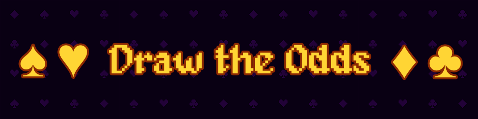
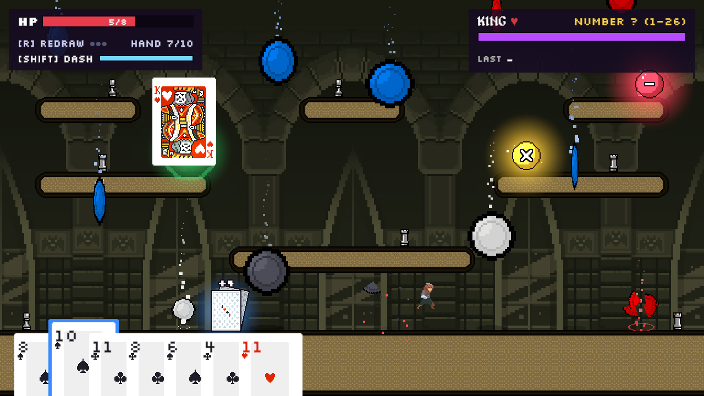
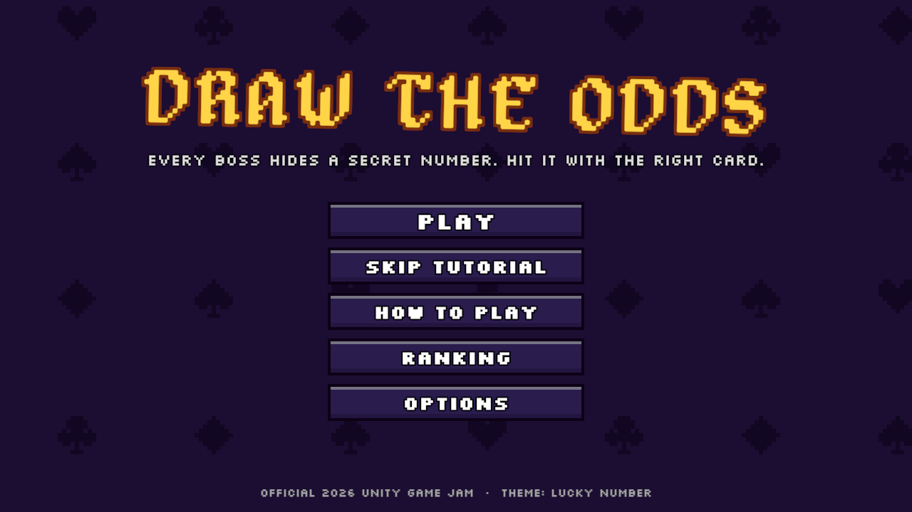
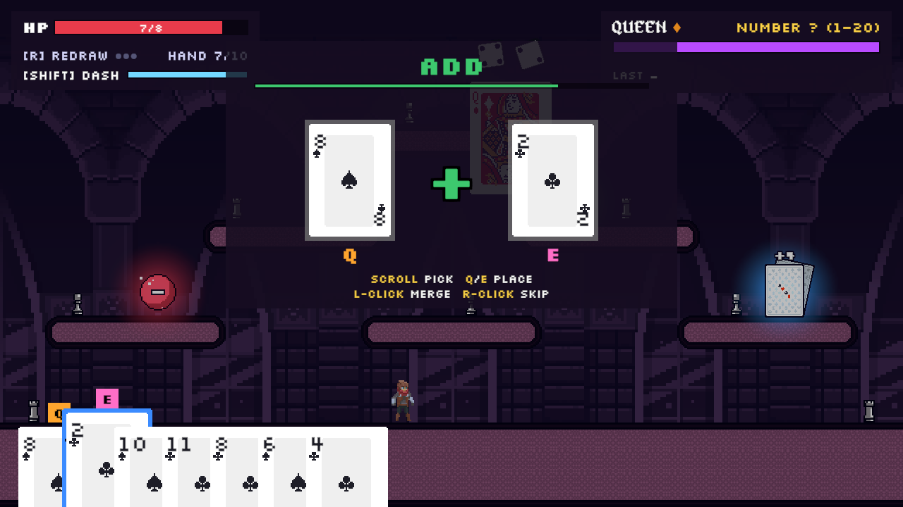
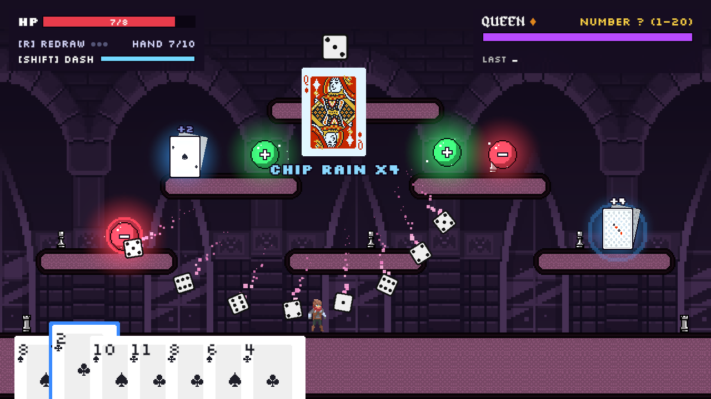
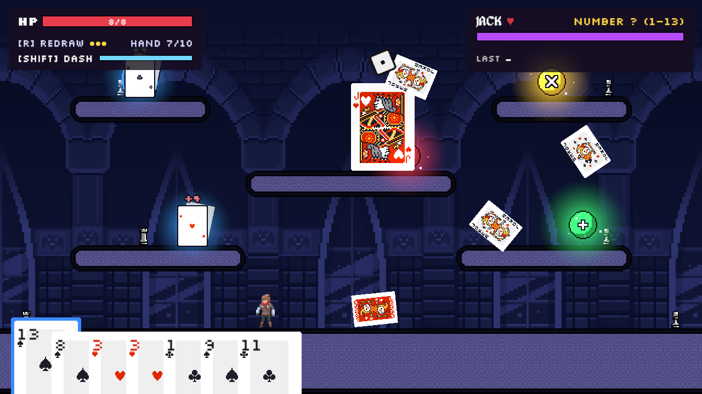

<p align="center">
  
</p>

<p align="center">
  <b>Every boss hides a secret number. Keep throwing cards until you find it.</b>
</p>

<p align="center">
  
  
  
  
</p>

---

**Draw the Odds** is a 2D pixel-art platformer **boss rush** where your only weapon is a deck of playing cards. Made for the **Official 2026 Unity Game Jam** (theme: **"Lucky Number"**).

Each boss (the Jack, the Queen and the King) is hiding a secret number. Throw cards at them: the closer your card is to that number, the harder it hits, and every throw tells you whether the number is **higher ▲** or **lower ▼**. Hit it exactly for a **critical**... and watch the boss roll a brand new number.

Missing the right card? Grab a power orb: **time stops** and you can **fuse two cards** with **+**, **−** or **×** to craft the number you need.

<p align="center">
  
</p>

## Features

- **3 bosses + a Joker tutorial.** Each boss rolls a die to choose its next attack: dice volleys, poker-chip rain, dashes and flying Jokers. Later bosses mix attacks and speed up as they lose health.
- **A guessing game with a deadline.** Damage depends on how close your card is (exact = critical, 1–2 away = strong, 3–5 = weak, 6+ = nothing). Use the ▲ / ▼ hints to find the number in as few throws as you can.
- **Suits matter.**
  - ♣ Clubs: normal damage
  - ♠ Spades: 1.5× damage
  - ♦ Diamonds: damage + draw a card
  - ♥ Hearts: heal yourself instead of hurting the boss
- **Card fusion with time stopped.** Combine two cards with add, subtract or multiply (up to 26) to reach numbers your hand doesn't have.
- **Bosses that cheat.** The Queen changes her number at half health; the King changes his every 25 seconds.
- **3 difficulty modes** (Easy, Normal, Hardcore), each with its own **online leaderboard**.
- Interactive tutorial, pause menu, volume and music options, **English and Portuguese (PT-BR)**.

## Screenshots

<table>
  <tr>
    <td></td>
    <td></td>
  </tr>
  <tr>
    <td align="center"><i>Main menu</i></td>
    <td align="center"><i>Card fusion: time stops while you pick two cards</i></td>
  </tr>
  <tr>
    <td></td>
    <td></td>
  </tr>
  <tr>
    <td align="center"><i>The Queen's die picks the next attack</i></td>
    <td align="center"><i>The Jack's flying Jokers</i></td>
  </tr>
</table>

## How to play

| Action | Key |
|---|---|
| Move | A / D (or arrows) |
| Jump (hold = higher) | Space |
| Drop through platform | S + Space |
| Dash (invincible) | Shift |
| Select card | Mouse wheel or 1–0 |
| Throw card | Left click (aims at the mouse) |
| Redraw hand (3 per run) | R |
| Fusion: put card in slot | Q / E |
| Fusion: confirm / skip | Left click / Right click |
| Pause | Esc or P |

*Keyboard and mouse required. Best played in fullscreen.*

**Tips**
- ▲ means the number is **higher** than your card, ▼ means **lower**. Warm colors mean you're close.
- After a critical the boss rolls a new number: start again from the middle of its range.
- Card packs appear when your hand runs low, so don't be afraid to throw.

## Scoring and leaderboard

Your run timer starts at the first boss (the tutorial doesn't count) and stops while the game is paused or during a fusion. The score is calculated **on the server**:

```
score = 20000 − 10 × seconds − 25 × cards thrown + 150 × criticals   (min. 1)
```

The leaderboard runs on [Supabase](https://supabase.com) (Postgres + PostgREST). The table is read-only for clients; runs are submitted through a `security definer` RPC that checks if the run is plausible, filters names and limits how often you can submit. Easy mode doesn't go to the ranking. Without internet the game keeps a local top 10.

## Tech

- **Unity 6** (6000.4), 2D, URP with 2D lights, Pixel Perfect Camera (640×360, 16 PPU)
- **C#** (code comments in Portuguese, since this project was also a way to learn C#)
- TextMesh Pro, Unity Input System, Audio Mixer (Master / Music / SFX / UI)
- **Supabase** for the online leaderboard
- **Aseprite** for the pixel art

### Project structure

```
Assets/_Game/
├── Art/          sprites, backgrounds, tiles, props
├── Audio/        music, SFX and the AudioMixer
├── Data/         GameConfig.asset: almost all balancing lives here
├── Fonts/
├── Prefabs/
├── Scenes/
└── Scripts/
    ├── Cards/    Card, Hand, FusionRules, FusionController
    ├── Combat/   LuckyMath (damage + hints), card and dice projectiles
    ├── Enemy/    BossData (attacks per die face), BossController (AI)
    ├── Player/   state machine (idle/run/jump/fall/dash), health, cards
    ├── Pickups/  card packs and power orbs
    ├── Level/    LevelBuilder (platform layouts per boss)
    ├── UI/       HUD, menus, fusion panel, tutorial, leaderboard
    ├── Audio/    AudioManager
    ├── Core/     GameManager, GameConfig, localization, VFX helpers
    └── Editor/   setup and build menus
Supabase/         SQL for the leaderboard (tables, views, RPC)
Tools/            itch.io packaging script, Aseprite export script
```

## Running the project

1. Clone the repository:
   ```bash
   git clone https://github.com/lucasjanta/Draw-the-Odds.git
   ```
2. Open the folder with **Unity 6000.4** (Unity Hub → Add project from disk).
3. Open `Assets/_Game/Scenes/Game.unity` and press Play.

**Builds:** use the `Draw the Odds` menu in the Editor (`Build WebGL` or `Build Windows`). Output goes to `Builds/` (not tracked by git).

**Balancing:** almost everything (hand size, card speed, orb spawn rate, boss HP, attacks per die face, difficulty modes, audio) is editable in the Inspector of `Assets/_Game/Data/GameConfig.asset`.

**Leaderboard (optional):** to use your own backend, run the SQL files in `Supabase/` on a Supabase project and put its URL and **publishable/anon key** in the leaderboard client. Never put the `service_role` key in the game.

## Credits

**Lucas Janta** ([@lucasjanta](https://github.com/lucasjanta)): game design, art direction, pixel art (bosses, card edits), audio selection.

**Art**
- Player character: [Adventurer](https://rvros.itch.io/animated-pixel-hero) by rvros
- Playing cards (recolored and edited): [Assets for 8bit Playing card games](https://sdkfz181tiger.itch.io/assets-for-8bit-playing-card-games) by sdkfz181tiger
- Dice: [Boardgame icons pack](https://oddnumberofeyes.itch.io/boardgame-icons-pack) by oddnumberofeyes
- Background: [Castle Tileset 16x16](https://pokrasmemas.itch.io/castletileset) by pokrasmemas
- Board props and felt: [ToyZone](https://cursed-offerings.itch.io/toyzone) by CURSED OFFERINGS

**Music**
"Second Dealing", "Hypnotic Poison", "Trust Me" [T-studio](https://t-studio-tst.itch.io/) by みんなの創作支援サイトＴスタ 

**Fonts**
- Silkscreen by Jason Kottke (SIL Open Font License)
- Alagard by Hewett Tsoi

**Sound effects**
- [Tabletop Games SFX Pack](https://jdsherbert.itch.io) by JDSherbert
- [Crisp Cards (Free Sampler)](https://anipixels.itch.io/crisp-cards-free) by anipixels

<!-- TODO: add the music composer and the poker chips author -->

**AI disclosure:** most of the code was written with **Claude (Anthropic)** as a coding assistant, following my design and direction. All art, music and sound effects are human-made assets credited above; no AI-generated art or audio.

---

<p align="center">Made in a few days for the Official 2026 Unity Game Jam ♠ ♥ ♦ ♣</p>
